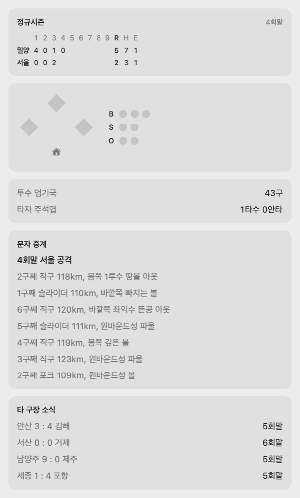

# Token Sport

AI 코딩 도구에서 쓴 토큰이 **구단 자금**이 되는 macOS 메뉴바 구단 육성 게임.
시민 구단으로 시작해 6부 리그의 최상위 프로 리그까지 올라가는 것이 목표다.
구단을 만들 때 **야구단**과 **축구단** 중에 고른다.
구단 대신 **야구 선수 한 명**이 되어, 토큰으로 훈련하며 타자나 투수를 키울 수도 있다.

> Token Baseball은 **KBO를 비롯한 실제 리그·구단과 무관한 비공식 팬 프로젝트**입니다. 등장하는 구단과 선수는 모두 가상입니다.



## 어떤 게임인가

- **토큰이 곧 자금**: Claude Code, Codex, Gemini CLI, opencode에서 쓴 토큰이 그대로 구단 자금으로 쌓인다. 평소처럼 일하면 구단이 굴러간다.
- **상단바에서 진행**: 상단바 아이콘을 누르면 홈, 경기, 리그, 구단, 선수, 설정 탭이 열린다. 경기 중에는 상단바에 스코어가 뜬다.
- **야구단 또는 축구단**: 구단을 만들 때 종목을 고른다. 두 종목의 구단은 따로 저장되고, 설정 탭에서 오갈 수 있다. 축구는 승점제에 무승부가 있고, 승강 플레이오프는 연장과 승부차기까지 간다.
- **실시간 문자 중계**: 야구는 공 하나씩, 축구는 경기 시간 20초씩 진행되고 건너뛸 수 없다. 한 경기에 15분쯤 걸리고, 경기 기회는 1시간에 하나씩 최대 3개까지 쌓인다.
- **6부 리그, 승격과 강등**: 리그마다 10팀이 36라운드를 치른다. 승격하려면 인지도를 쌓고 시즌 중에 신청해야 한다. 10위는 자동 강등, 9위는 승강 플레이오프를 치른다.
- **구단 운영**: 훈련소·경기장·스카우트 시설을 올리고, 홍보로 인지도를 쌓고, 연봉을 감당하지 못하면 파산한다. 파산해도 새 구단으로 같은 세계에서 다시 시작한다.
- **선수 영입과 계약**: 입단 테스트, 스카우트, 신인 드래프트, FA, 이적 제안, 재계약. 시즌이 끝나면 친선 5경기를 치르는 동안 이적 시장이 열린다.
- **살아 있는 세계**: 다른 59개 구단도 선수가 성장하고 은퇴하며 승격·강등된다.
- **야구 선수 모드**: 16세 타자나 투수로 6부 구단에 입단한다. 토큰이 훈련 포인트가 되어, 티 배팅·웨이트·불펜 피칭 같은 훈련으로 능력치를 올린다. 경기마다 평점이 나오고, 감독 신뢰와 명성을 쌓아 윗 리그 구단으로 옮겨 간다.

자세한 규칙은 [기획 문서](docs/README.md)에 있다.

## 설치

아직 내려받아 바로 쓰는 배포 파일(.dmg, .zip)은 없다. 소스를 받아 직접 빌드한다.

**필요한 것**

- macOS 14 (Sonoma) 이상
- Xcode 16 이상 (Swift 6). App Store에서 설치한 뒤 한 번 실행해 둔다

**1. 받기**

```sh
git clone https://github.com/pokohen/token-baseball.git
cd token-baseball
```

git을 쓰지 않으면 GitHub 저장소 페이지의 **Code → Download ZIP**으로 받아 압축을 풀어도 된다.

**2. 앱 만들기**

```sh
Scripts/make-app.sh
```

`build/Token Baseball.app`이 생긴다. 처음에는 빌드에 1~2분 걸린다.

**3. 실행**

```sh
open "build/Token Baseball.app"
```

- 상단바(메뉴 막대)에 아이콘이 생긴다. Dock에는 나타나지 않는다.
- 아이콘을 누르면 구단 만들기 화면이 나온다.
- 처음 실행하면 알림을 허용할지 묻는다. 경기 종료와 득점 소식을 알림으로 받는다.
- 계속 쓰려면 앱을 응용 프로그램 폴더로 옮긴다: `cp -R "build/Token Baseball.app" /Applications/`
- 맥을 켤 때 자동으로 실행하려면 **시스템 설정 → 일반 → 로그인 항목**에 앱을 추가한다.
- 끝낼 때는 설정 탭의 **앱 종료**를 누른다.

직접 빌드한 앱이라 보통은 바로 열린다. ZIP으로 받았거나 다른 맥에서 만든 앱을 옮겨 와서 "확인되지 않은 개발자" 경고가 나오면, Finder에서 앱을 **우클릭 → 열기**로 한 번 열어 준다.

**업데이트**

```sh
git pull
Scripts/make-app.sh
```

실행 중인 앱을 끄고 새로 만든 앱으로 바꾼다. 저장 파일은 그대로 이어진다.

**삭제**

앱을 지우고, 저장 파일까지 없애려면 `~/Library/Application Support/TokenBaseball` 폴더를 지운다.

## 알아 둘 것

- 토큰 사용량은 `~/.claude/projects`(Claude Code), `~/.codex/sessions`(Codex), `~/.gemini/tmp`(Gemini CLI), `~/.local/share/opencode`(opencode)의 로컬 로그에서 읽는다. 외부로 보내지 않는다. Gemini CLI와 opencode는 각 도구의 소스 코드를 보고 만들었고, 실제 로그로는 아직 확인하지 못했다.
- 구단을 만든 뒤에 쓴 토큰만 자금이 된다. 20초마다 반영된다.
- 게임은 `~/Library/Application Support/TokenBaseball/save.json`에 저장된다. 이 파일을 복사해 두면 백업이 된다.
- 경기 기회는 1시간에 하나씩, 최대 3개까지 쌓인다. 경기 한 번은 실시간으로 15분쯤 걸리고 건너뛸 수 없다.
- 야구 구단, 축구 구단, 야구 선수는 따로 저장된다 (같은 폴더의 `save-football.json`, `save-baseball-player.json`). 설정 탭에서 모드를 바꾸면 그쪽으로 넘어가고, 없으면 새로 만든다.
- 한 번에 하나만 진행한다. 쉬는 구단·선수는 그동안 쓴 토큰을 받지 않고 경기 기회도 쌓이지 않는다.

## 개발

```sh
swift run TokenBaseball        # 앱 번들 없이 바로 실행 (알림은 나오지 않음)
swift test                     # 테스트
TB_STRESS=1 swift test --filter StressTests   # 여러 시드 장기 시뮬레이션 (야구 6분, 축구 9분쯤)
```

진짜 구단을 건드리지 않고 시험하려면 저장 위치를 바꿔 실행한다. 직접 눌러 확인할 항목은 [테스트 안내](docs/TESTING.md)에 있다.

```sh
TOKEN_BASEBALL_SAVE=/tmp/tb-test.json swift run TokenBaseball
```

## 구조

```
Sources/
  TokenBaseballCore/   게임 로직 (UI 의존 없음)
    Usage/             로컬 로그에서 토큰 사용량 읽기
    League/            리그, 팀, 일정, 순위
    Match/             경기 시뮬레이션 (야구는 투구 단위, 축구는 20초 단위)
    Players/           선수 생성, 능력·잠재력
    Club/              자금 장부
    Career/            선수 모드의 상태 (내 선수, 제안, 시즌 기록)
    Persistence/       저장
    Game*.swift        게임 전체 상태와 명령 (경기, 세계 시뮬레이션, 시즌, 구단, 이적 시장, 선수 모드)
    Balance.swift      조정할 수 있는 수치 모음
  TokenBaseball/       macOS 앱 (상단바, 팝오버, 설정)
Tests/
  TokenBaseballCoreTests/
```

기획 문서는 [docs](docs/README.md)에 있다.

## 개발용 환경 변수

| 변수 | 내용 |
|---|---|
| `TOKEN_BASEBALL_SAVE` | 저장 파일 위치를 바꾼다 (축구 저장 파일과 종목 표시 파일도 같은 폴더에 생긴다) |
| `TOKEN_BASEBALL_SNAPSHOT` | 각 화면을 이 폴더에 PNG로 그리고 끝낸다 (임시 게임 사용, 축구 화면은 `football/` 아래) |
