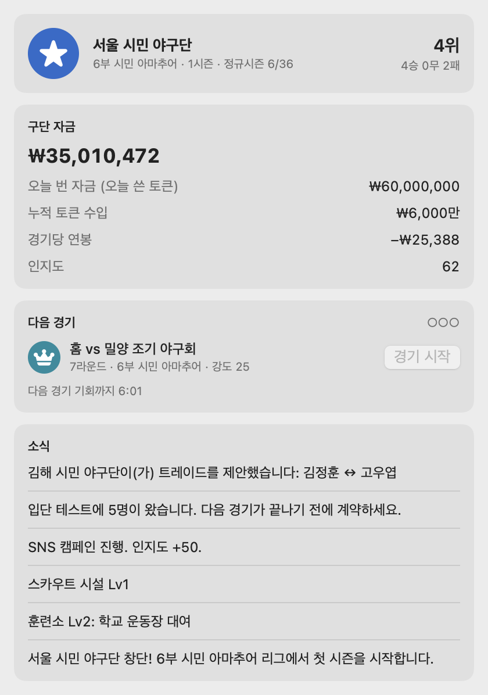
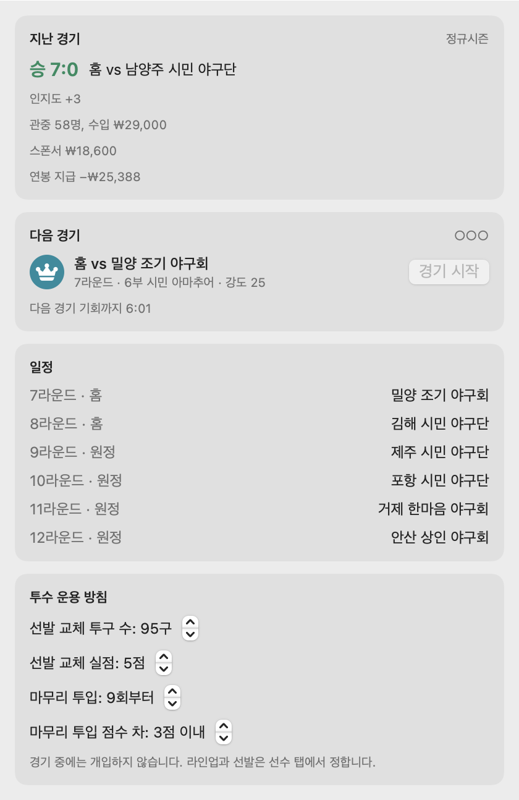
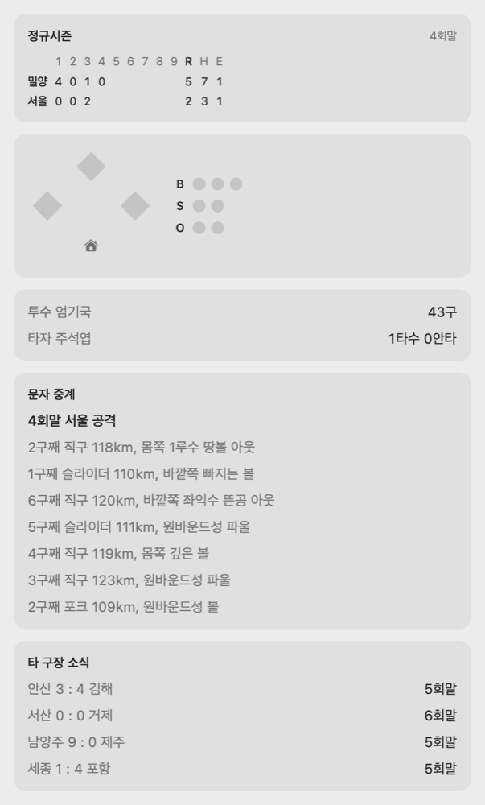
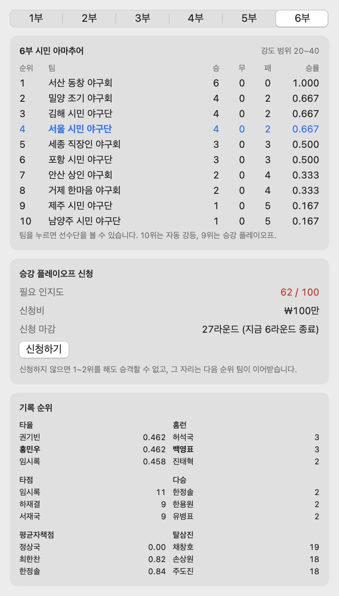
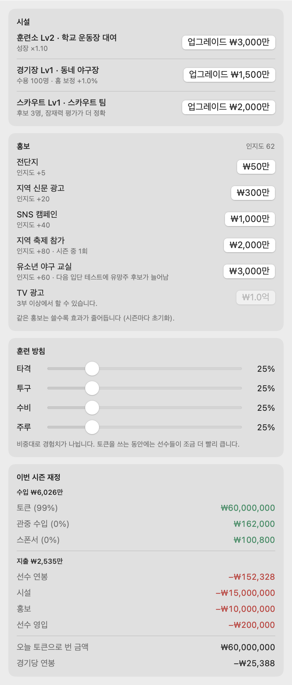
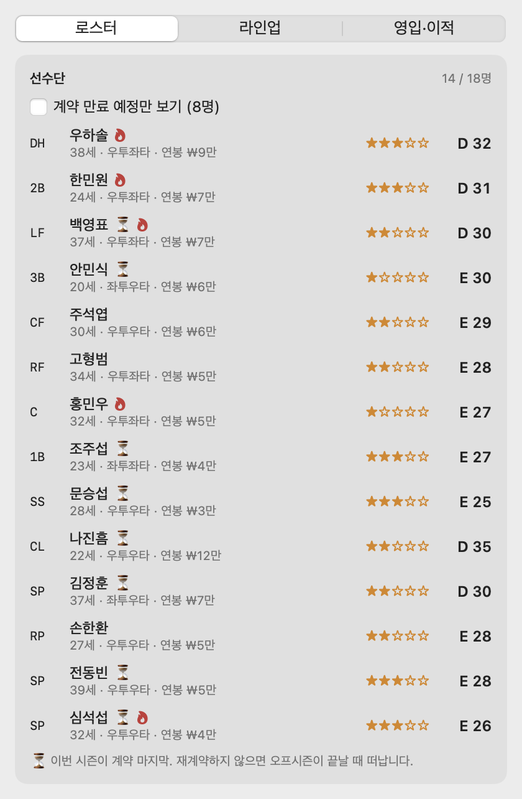
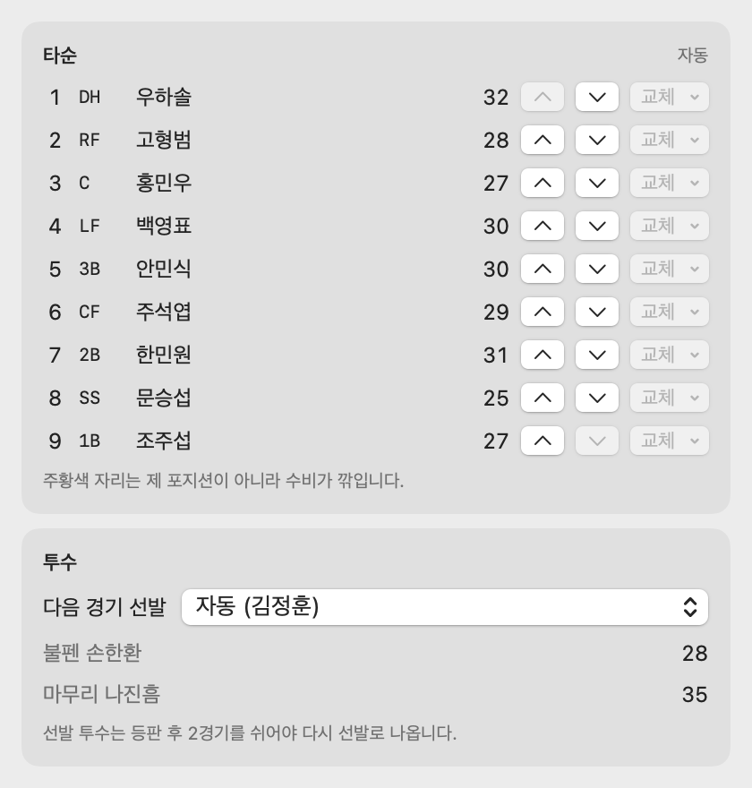
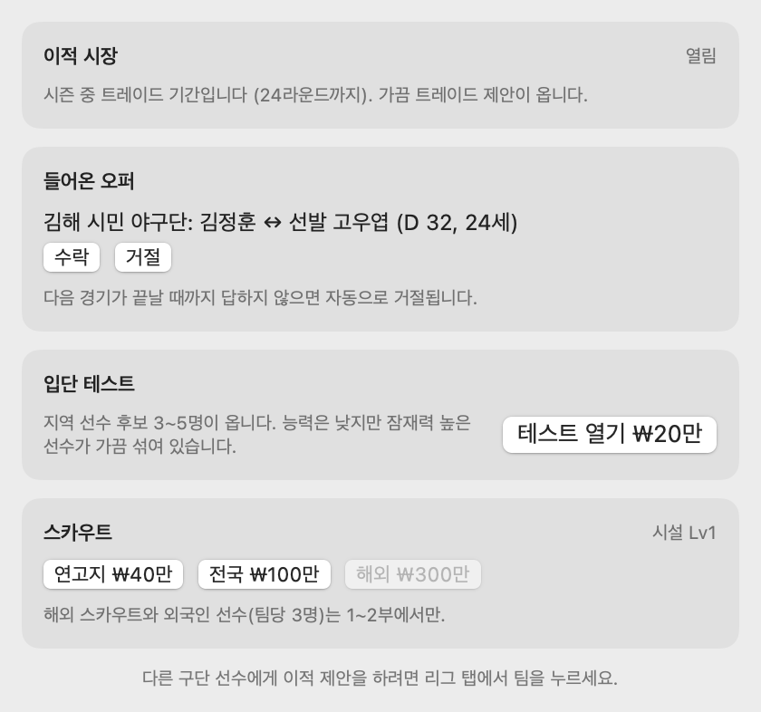

# 야구 구단 경영

시민 야구단의 구단주가 되어, 코딩하며 쓴 토큰을 자금 삼아 6부에서 1부 프로 리그까지 올라간다.

[플레이 가이드 목록](README.md) · 규칙의 근거: [메인](../01-main.md), [경기](../02-match.md), [리그](../03-league.md), [구단 운영](../04-club-management.md), [선수 영입](../05-player-recruitment.md)

## 시작하기

1. 앱을 켜고 상단바 아이콘을 누른다.
2. "무엇을 할지 골라 주세요"에서 **야구 구단**을 고른다.
3. 연고지(16개 도시), 팀 이름, 팀 색상과 엠블럼을 차례로 정한다. 팀 이름을 비우면 "○○ 시민 야구단"이 된다.
4. "구단 창단"을 누르면 6부 시민 아마추어 리그에서 선수 14명, 자금 ₩100,000으로 시작한다.

## 하루의 흐름

1. 평소처럼 AI 코딩을 한다. 쓴 토큰이 자금으로 쌓인다.
2. 경기 기회가 생기면 상단바를 열어 **경기 시작**을 누른다.
3. 15분쯤 중계가 흐르는 동안 하던 일을 계속한다. 상단바에 스코어가 나온다.
4. 경기가 끝나면 모인 자금으로 시설을 올리거나 선수를 영입한다.

## 홈 탭

- **맨 위**: 팀 이름, 리그, 시즌과 라운드, 지금 순위와 전적.
- **구단 자금**: 지금 가진 돈, 오늘 토큰으로 번 돈, 경기마다 나가는 연봉, 인지도.
- **다음 경기**: 상대와 상대 팀 강도. 오른쪽 위 동그라미가 남은 경기 기회다 (⚾가 채워진 만큼 치를 수 있다). 기회가 없으면 "다음 경기 기회까지" 남은 시간이 나온다.
- **소식**: 오퍼, 영입 후보, 시설 완공, 다른 구단 소식.

자금이 다음 5경기 연봉보다 적으면 주황색 경고가, 0 아래로 내려가면 빨간 위기 알림이 뜬다.

## 경기 탭

- **지난 경기**: 결과와 정산 (인지도, 관중 수입, 스폰서, 연봉 지급).
- **일정**: 앞으로 여섯 라운드의 상대와 홈·원정.
- **투수 운용 방침**: 경기 전에 정해 두면 경기는 그대로 흘러간다. 경기 중에는 개입할 수 없다.

| 방침 | 뜻 | 요령 |
|---|---|---|
| 선발 교체 투구 수 | 선발이 이만큼 던지면 바꾼다 | 불펜이 약하면 올리고, 선발 체력이 낮으면 내린다 |
| 선발 교체 실점 | 선발이 이만큼 실점하면 바꾼다 | |
| 마무리 투입 | 몇 회부터 마무리를 올릴지 | |
| 마무리 투입 점수 차 | 몇 점 차 이내로 앞설 때 올릴지 | |

### 중계

공 하나씩 진행된다. 스코어보드, 주자와 볼카운트, 지금 투수와 타자, 문자 중계, 같은 라운드의 다른 구장 소식이 나온다. 팝오버를 닫아도 경기는 계속되고, 앱을 껐다 켜도 이어진다.

## 리그 탭

- 위쪽 버튼으로 1부~6부 순위표를 본다. 내 구단은 파란색이다.
- **팀을 누르면** 그 팀의 선수단이 펼쳐진다. 이적 기간에는 선수 옆의 "제안" 버튼으로 이적 제안을 보낼 수 있다. 답은 다음 경기가 끝난 뒤에 온다.
- **승강 플레이오프 신청**: 승격하려면 **27라운드 전에 신청**해야 한다. 인지도가 기준을 넘어야 하고 신청비가 든다. 신청하지 않으면 1~2위를 해도 승격하지 못한다.
- **기록 순위**: 타율, 홈런, 타점, 다승, 평균자책점, 탈삼진. 내 선수는 굵게 나온다.

시즌이 끝나면 1위는 자동 승격, 2위는 윗 리그 9위와 3전 2선승의 승강 플레이오프를 치른다. 10위는 자동 강등이다.

## 구단 탭

| 카드 | 하는 일 |
|---|---|
| **시설** | 훈련소는 선수 성장 속도를, 경기장은 관중 수입과 홈 보정을, 스카우트는 영입 후보의 수와 잠재력 평가의 정확도를 올린다 |
| **홍보** | 돈을 내고 인지도를 바로 올린다. 같은 홍보는 쓸수록 효과가 줄고 시즌마다 초기화된다 |
| **훈련 방침** | 타격·투구·수비·주루의 비중. 비중대로 선수들의 경험치가 나뉜다 |
| **이번 시즌 재정** | 수입과 지출 내역 |

## 선수 탭

위쪽 버튼으로 로스터, 라인업, 영입·이적을 오간다.

### 로스터

- 오른쪽 숫자가 능력, 그 앞 글자가 등급(F~S)이다. **별**은 스카우트가 본 잠재력이고, 스카우트 시설이 낮으면 틀릴 수 있다.
- ⏳는 이번 시즌이 계약 마지막인 선수, 🔥는 직전 경기에서 활약해 컨디션이 좋은 선수다.
- 선수를 누르면 세부 능력치와 재계약, 방출이 나온다.

### 라인업

- 화살표로 타순을 바꾸고 "교체"로 벤치 선수와 바꾼다. 손대지 않으면 능력 순으로 자동 구성된다.
- 제 포지션이 아닌 자리에 서면 주황색으로 표시되고 수비가 깎인다.
- "다음 경기 선발"로 선발 투수를 지정한다. 선발은 등판 뒤 며칠 쉬어야 다시 나온다 (시민 리그 2경기, 3부부터 4경기).

### 영입·이적

| 경로 | 내용 |
|---|---|
| **입단 테스트** | 싸게 지역 선수 후보 3~5명을 본다. 능력은 낮지만 잠재력 높은 선수가 가끔 섞여 있다 |
| **스카우트** | 연고지·전국·해외로 보낸다. 몇 경기 뒤에 후보를 데리고 돌아온다. 해외와 외국인 선수(팀당 3명)는 1~2부에서만 |
| **들어온 오퍼** | 다른 구단이 내 선수를 달라고 한다. 다음 경기가 끝날 때까지 답하지 않으면 자동 거절 |
| **신인 드래프트** | 3부부터, 오프시즌 친선 3경기 뒤에 열린다 |

이적 기간은 정규시즌 24라운드까지와 오프시즌이다.

## 꼭 알아 둘 것

- **연봉은 경기마다 나간다.** 자금이 0 아래로 내려가면 5경기 유예가 주어지고, 그 안에 메우지 못하면 **파산**해 구단이 해체된다. 같은 세계에서 새 구단으로 다시 시작한다.
- **계약이 끝나면 선수가 떠난다.** ⏳ 선수는 오프시즌이 끝나기 전에 재계약해야 한다.
- **강등되면** 인지도가 크게 떨어지고, 다른 구단의 오퍼가 몰려온다.
- **가격 난이도**(설정 탭)로 시설·홍보·영입·연봉 비용을 10%~200%로 조절한다. 토큰을 많이 쓰는 사람은 올리고, 적게 쓰는 사람은 내린다.
- **CPU 팀 맞춰주기**(설정 탭)는 다른 구단이 내 구단 수준을 얼마나 따라오는지를 정한다.

## 처음 며칠의 요령

1. 첫 자금으로는 **입단 테스트**를 열어 잠재력 높은 선수를 찾는다.
2. 자금이 모이면 **훈련소**부터 올린다. 모든 선수가 빨리 큰다.
3. 순위가 1~2위권이면 **홍보로 인지도를 채우고 27라운드 전에 승격을 신청**한다.
4. 승격하면 연봉이 오른다. 승격 직후에는 자금을 넉넉히 남겨 둔다.
