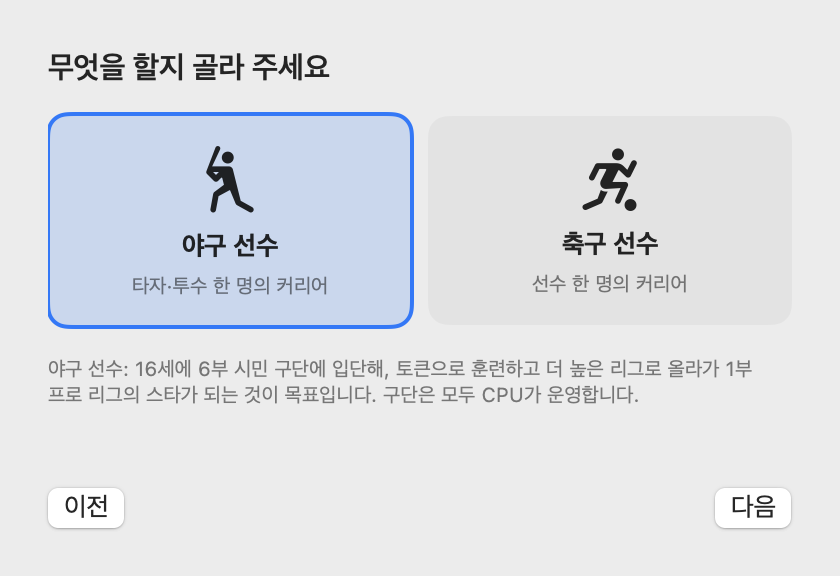
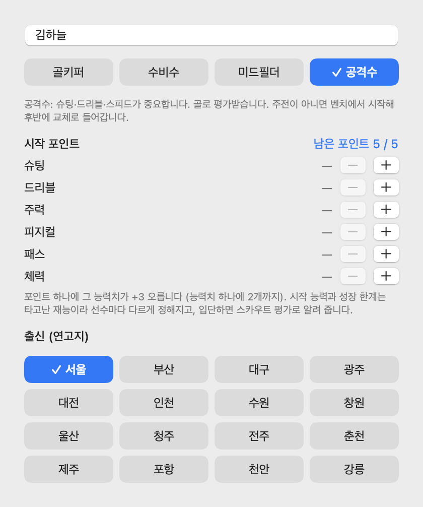
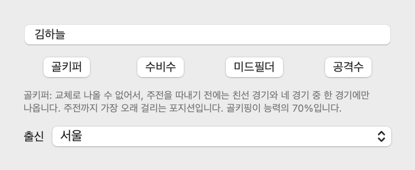
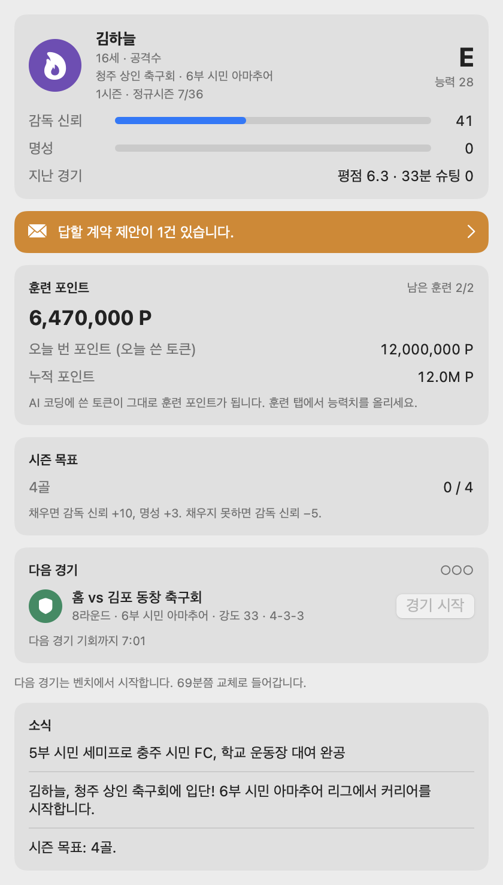
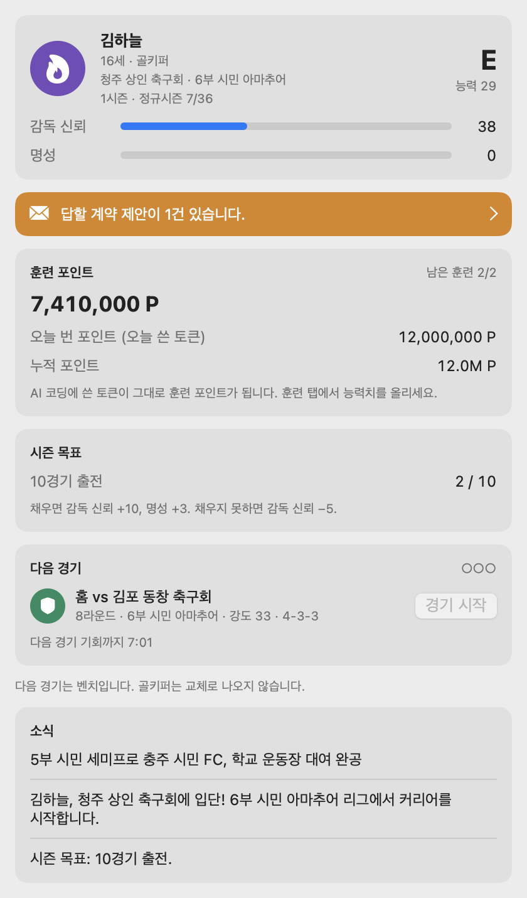
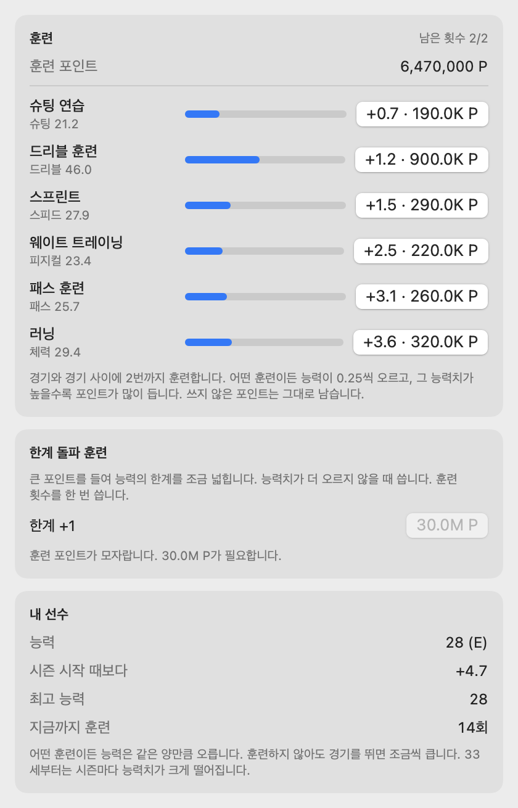
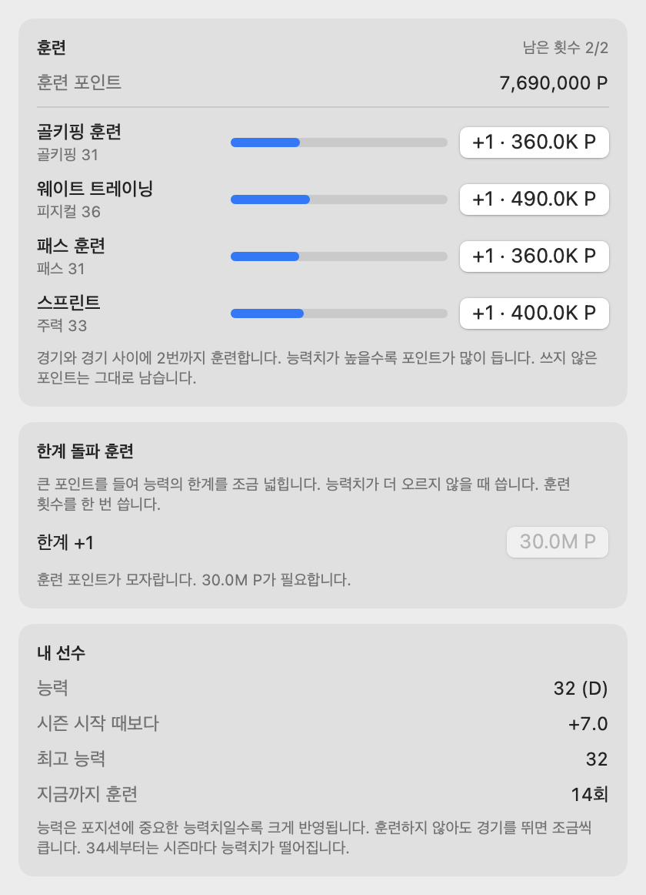
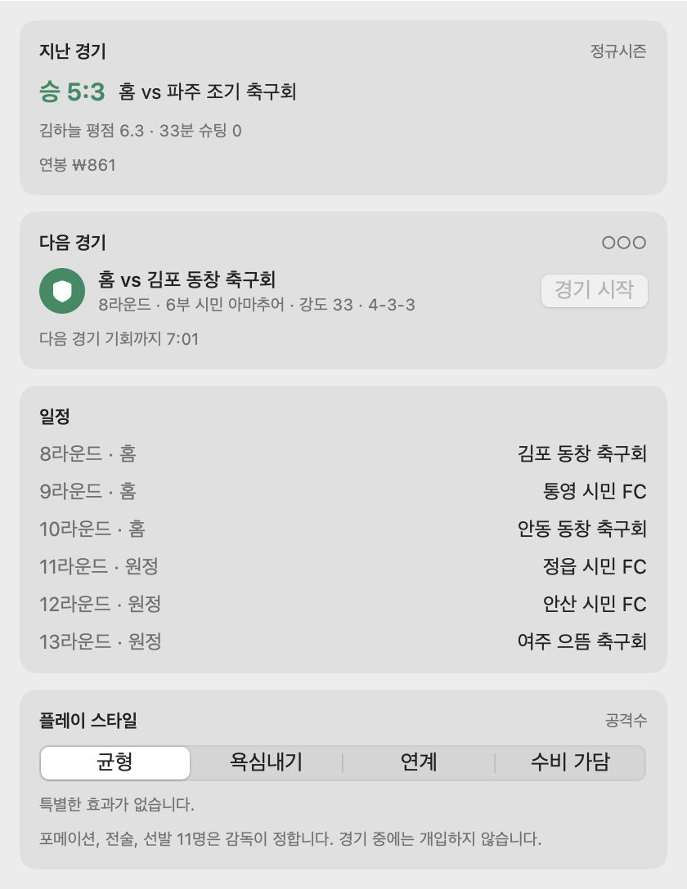
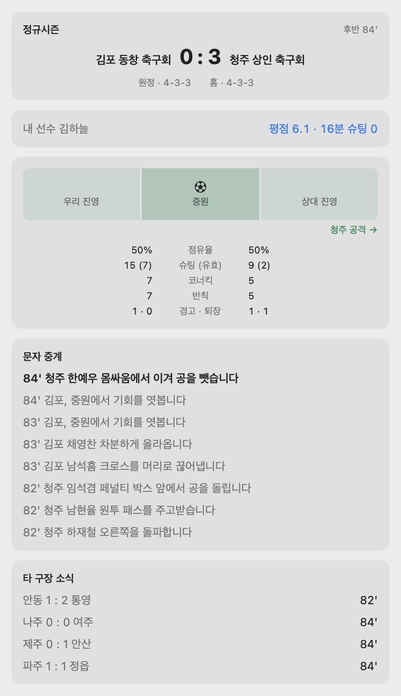
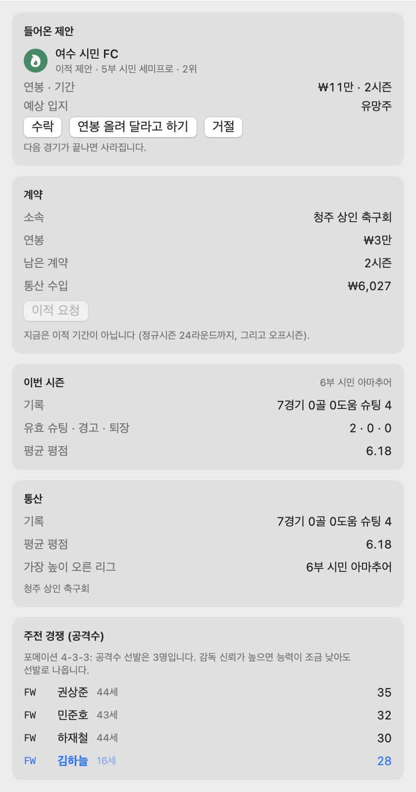

# 축구 개인 성장

구단을 운영하는 대신 **축구 선수 한 명**이 된다. 16세에 6부 시민 구단에 입단해, 코딩하며 쓴 토큰으로 훈련하고, 주전을 따내고, 더 높은 리그의 구단으로 옮겨 가며 1부 프로 리그의 스타가 되는 것이 목표다.

[플레이 가이드 목록](README.md) · 규칙의 근거와 수치: [축구 선수 모드](../08-player-mode.md) · 전문가 검토: [축구 검토](../review/football.md)

## 구단 경영과 무엇이 다른가

| | 축구 구단 경영 | 축구 개인 성장 |
|---|---|---|
| 내가 되는 것 | 구단주 | 선수 한 명 |
| 토큰 | 구단 자금 | 훈련 포인트 |
| 키우는 것 | 구단 전체 | 내 선수의 능력치, 감독 신뢰, 명성 |
| 경기 전에 정하는 것 | 포메이션, 전술, 선발 11명 | 내 플레이 스타일 |
| 올라가는 길 | 구단이 승격한다 | 구단이 승격하거나, 내가 윗 리그 구단으로 옮긴다 |
| 실패 | 파산 | 없다. 방출돼도 다른 구단을 찾는다 |
| 끝 | 없다 | 은퇴 |

[야구 개인 성장](baseball-player.md)과 가장 다른 점은 **주전 경쟁**이다. 야구 타자는 매 경기 선발로 나오지만, 축구 선수는 실력으로 선발 자리를 따내야 한다. 못 따내면 벤치에서 시작해 후반에 교체로 들어간다.

## 시작하기

1. 처음 화면이나 설정 탭의 "모드"에서 **축구 선수**를 고른다.
2. 선수를 만든다: 이름, 포지션, 출신.

3. "커리어 시작"을 누르면 6부 시민 아마추어 리그의 구단에 입단한다. 나이 16세, 훈련 포인트 100,000 P.

### 어떤 포지션을 고를까

포지션은 커리어 중에 바꿀 수 없다.

| 포지션 | 능력에 중요한 것 | 평점을 받는 길 | 이런 사람에게 |
|---|---|---|---|
| **공격수** | 슈팅 38% · 드리블 20% · 스피드 17% | 골 (+1.0), 유효 슈팅 | 골로 평가받고 싶다. 골이 없는 경기는 평점이 낮다 |
| **미드필더** | 패스 35% · 드리블 20% · 수비 15% · 체력 15% | 도움, 공을 앞으로 운반하기, 공 뺏기 | 꾸준한 평점. 여러 능력치가 고르게 쓰인다 |
| **수비수** | 수비 40% · 피지컬 20% · 스피드 15% · 패스 15% | 공 뺏기, 걷어내기, 무실점 (+0.5) | 팀이 실점하지 않으면 평점이 오른다 |
| **골키퍼** | 골키핑 70% | 선방 (+0.25), 무실점 (+0.5). 실점하면 −0.3 | 가장 느린 길. 주전이 되면 매 경기 90분을 뛰고, 늦은 나이까지 뛴다 |

**골키퍼는 특별하다.** 교체로 나올 수 없어서, 주전을 따내기 전에는 친선 경기와 네 경기 중 한 경기에만 나온다. 대신 32세까지 훈련할 수 있고 41세까지 뛴다 (필드 선수는 29세, 38세).

## 하루의 흐름

1. 평소처럼 AI 코딩을 한다. 쓴 토큰이 훈련 포인트로 쌓인다.
2. **훈련 탭**에서 훈련을 다섯 번까지 한다.
3. **경기 탭**에서 플레이 스타일을 고른다 (바꾸지 않으면 지난번 그대로다).
4. 경기 기회가 생기면 **경기 시작**을 누른다.
5. 경기가 끝나면 평점이 나오고, 훈련 횟수가 다시 채워진다.

## 홈 탭

- **선수 카드**: 나이, 포지션, 소속 구단과 리그, 능력과 등급(F~S).
- **감독 신뢰** (0~100): 선발 경쟁과 교체로 들어가는 시간을 정한다.
- **명성** (0~100): 이적 제안이 오는 빈도를 정한다.
- **지난 경기**: 평점과 한 줄 기록 (뛴 시간, 골·도움, 슈팅, 수비 횟수).
- **주황색 알림**: 답할 계약 제안이 있을 때.
- **훈련 포인트**와 남은 훈련 횟수.
- **시즌 목표**: 감독이 준 목표와 진행.
- **다음 경기**: 그 아래에 다음 경기에 어떻게 나오는지 한 줄로 나온다.

| 다음 경기 안내 | 뜻 |
|---|---|
| 다음 경기에 선발로 나섭니다 | 선발 11명에 들었다 |
| 다음 경기는 벤치에서 시작합니다. 68분쯤 교체로 들어갑니다 | 선발에서 밀렸다. 적힌 시간에 반드시 들어간다 |
| 다음 경기는 벤치입니다. 골키퍼는 교체로 나오지 않습니다 | 주전이 아닌 골키퍼가 쉬는 경기 |
| 출장 정지로 다음 리그 경기에 나서지 못합니다 | 퇴장했거나 시즌 경고가 다섯 장 쌓였다 |

## 주전 경쟁

감독은 같은 포지션 선수들의 능력을 비교해 선발을 정한다. 포메이션에서 내 포지션이 서는 자리 수만큼이 선발이다.

| 포메이션 | 수비수 | 미드필더 | 공격수 |
|---|---|---|---|
| 4-4-2, 4-1-2-1-2 | 4 | 4 | 2 |
| 4-3-3 | 4 | 3 | 3 |
| 4-2-3-1 | 4 | 5 | 1 |
| 3-5-2 | 3 | 5 | 2 |
| 3-4-3 | 3 | 4 | 3 |
| 5-3-2 | 5 | 3 | 2 |

- **선발 조건**: `내 능력 + 감독 신뢰 보정`이 선발 자리 안에 든다. 보정은 신뢰 50에서 0이고, 신뢰 100이면 +5, 신뢰 0이면 −5다. 감독이 믿으면 능력이 조금 낮아도 선발로 나온다.
- **선발이 아니면** 벤치에서 시작해 정해진 시간에 **반드시** 교체로 들어간다. 같은 자리에서 가장 지친 선수와 바뀐다.

| 감독 신뢰 | 0 | 20 | 40 | 60 | 80 이상 |
|---|---|---|---|---|---|
| 교체로 들어가는 시간 | 85분 | 80분 | 70분 | 60분 | 50분 |

커리어 탭의 **주전 경쟁** 카드에서 같은 포지션 선수들의 능력을 볼 수 있다. 몇 명을 넘어서야 선발인지가 보인다.

## 훈련 탭

훈련을 고르면 버튼에 적힌 만큼 그 능력치가 오르고 포인트가 든다. **어떤 훈련이든 능력(선수 카드의 숫자)은 0.25 오른다.** 포지션에서 덜 중요한 능력치는 한 번에 많이 오르고, 중요한 능력치는 조금씩 오른다.

| 훈련 | 오르는 능력치 | 경기에서 |
|---|---|---|
| 슈팅 연습 | 슈팅 | 슈팅을 더 자주 가져가고, 유효 슈팅과 골이 는다 |
| 패스 훈련 | 패스 | 도움을 더 자주 올리고, 공을 앞으로 운반하는 장면에 더 나선다 |
| 드리블 훈련 | 드리블 | 공을 앞으로 운반하는 장면에 더 나선다 |
| 수비 훈련 | 수비 | 공을 뺏고 걷어내는 장면에 더 나선다 |
| 스프린트 | 스피드 | 팀의 공격과 수비 싸움에 보탬이 된다 |
| 웨이트 트레이닝 | 피지컬 | 팀의 중원과 수비 싸움에 보탬이 된다 |
| 골키핑 훈련 | 골키핑 | 선방 확률이 오른다 |
| 러닝 | 체력 | 늦게 지친다. 지치면 모든 능력이 깎이고 먼저 교체된다 |

포지션마다 할 수 있는 훈련이 다르다 (그 포지션의 능력에 들어가는 능력치만).

**알아 둘 규칙**

- **경기 사이에 다섯 번**까지만 훈련한다. 경기를 치르면 다시 채워진다. 쓰지 않은 포인트는 그대로 남는다.
- **크리티컬**: 훈련할 때마다 1% 확률로 크리티컬이 터져, 같은 포인트로 세 배 오른다 (+0.25 → +0.75). 훈련 탭에 "크리티컬!"이 뜨고, 지금까지 몇 번 터졌는지는 "내 선수" 카드에 나온다. 한계와 최고치 99는 넘지 못한다.
- **비용은 그 능력치가 높을수록 비싸고, 훈련할 때마다 조금씩 오른다.** 25에서 25만 P, 50에서 116만 P, 70에서 397만 P, 85에서 1,000만 P.
- **리그 한도**: 훈련으로는 지금 리그 수준보다 조금 위까지만 오른다. 그 위로 가려면 구단이 승격하거나 윗 리그 구단으로 옮겨야 한다.

| 지금 리그 | 6부 | 5부 | 4부 | 3부 | 2부 | 1부 |
|---|---|---|---|---|---|---|
| 훈련으로 오르는 능력의 한도 | 45 | 55 | 65 | 75 | 85 | 없음 |

- 선수마다 숨겨진 **한계(잠재력)** 가 있다. 가까워지면 비용이 두 배가 되고, 닿으면 더 오르지 않는다. **한계 돌파 훈련**(3,000만 P)으로 +1 넓힌다.
- **필드 선수는 29세, 골키퍼는 32세부터 훈련으로 올릴 수 없다.**
- 훈련하지 않아도 경기를 뛰면 조금씩 큰다.

### 무엇을 올릴까

능력은 어느 훈련으로나 똑같이 오른다. 그래서 고민할 것은 "능력을 얼마나 올리나"가 아니라 **"어떤 선수가 될 것인가"** 다.

- **비용**: 값이 낮은 능력치가 싸다. 같은 포인트로 훈련을 더 많이 하려면 낮은 것부터 올린다.
- **평점**: 평점은 실제로 한 일에서 나온다. 공격수는 슈팅, 미드필더는 패스, 수비수는 수비, 골키퍼는 골키핑을 올려야 그 일을 더 자주, 더 잘 한다.
- **체력**: 주전인데 60분쯤에 교체된다면 체력이 모자란 것이다.

## 경기 탭: 플레이 스타일

경기 전에 플레이 스타일을 하나 고른다. 포메이션, 전술, 선발 11명은 감독이 정한다. 골키퍼는 스타일이 없다.

| 스타일 | 효과 | 대가 | 언제 |
|---|---|---|---|
| **균형** | 없음 | 없음 | 기본 |
| **욕심내기** | 슈팅을 1.7배 자주 가져간다 | 무리한 슈팅이 섞여 정확도가 떨어진다. 도움과 수비 장면이 줄어든다 | 골 목표를 채워야 할 때, 슈팅이 좋은 공격수 |
| **연계** | 도움을 1.7배 자주 올리고, 도움 하나의 평점이 0.6 → 0.8 | 슈팅이 줄어든다 | 패스가 좋은 미드필더, 공격 포인트 목표 |
| **수비 가담** | 공을 뺏고 걷어내는 장면에 2배 자주 나선다 | 체력이 1.2배 빨리 준다. 슈팅이 줄어든다 | 수비수, 수비가 좋은 미드필더. 체력이 받쳐 줄 때 |

"지난 경기"에는 평점, 감독 신뢰 변화, 받은 연봉이 나온다.

## 중계

구단 경영과 같은 중계 화면에 **내 선수 줄**이 더해진다. 벤치에 있으면 "벤치에서 대기 중", 들어간 뒤에는 평점과 기록(뛴 시간, 골, 슈팅, 수비 횟수)이 실시간으로 바뀐다. 문자 중계에서 내 선수가 나온 장면은 파란색으로 강조된다.

### 평점

1.0~10.0이고 6.0이 "무난했다"이다.

| 한 일 | | 못한 일 | |
|---|---|---|---|
| 골 | +1.0 | 반칙 | −0.1 |
| 도움 | +0.6 | 경고 | −0.3 |
| 유효 슈팅 | +0.15 | 퇴장 | −1.5 |
| 공을 앞으로 운반 | +0.05 | 실점 (골키퍼) | −0.3 |
| 공 뺏기 | +0.12 | | |
| 걷어내기·슈팅 막기 | +0.12 | | |
| 선방 (골키퍼) | +0.25 | | |
| 무실점 (골키퍼·수비수, 60분 이상) | +0.5 | | |

- 팀이 이기면 +0.2, 지면 −0.2.
- **짧게 뛰면 6.0 쪽으로 당겨진다.** 20분 뛰고 한 골을 넣어도 90분 뛰고 넣은 골만큼 오르지는 않는다.

### 감독 신뢰와 명성

| | 오르는 때 | 내리는 때 | 하는 일 |
|---|---|---|---|
| **감독 신뢰** | 평점 7.0 이상, 시즌 목표 달성 (+10), 훈련 (조금) | 평점 6.0 미만, 시즌 목표 실패 (−5), 이적 요청 (−10) | 선발 경쟁에서 −5 ~ +5 보정, 교체로 들어가는 시간. **30 아래면 계약이 끝날 때 재계약 제안을 받지 못한다** |
| **명성** | 평점 6.3을 넘긴 경기, 수상, 시즌 목표 달성 | 시즌이 바뀔 때 10% | 이적 제안이 더 자주 오고 연봉 협상이 잘 된다 |

- 30분도 못 뛴 교체 출전은 신뢰가 조금만 움직인다 (평점 6.5 이상이면 +0.5, 5.7 미만이면 −0.5). **교체로만 나와서는 신뢰를 올리기 어렵다.**
- 구단을 옮기면 감독 신뢰는 40에서 다시 시작한다.

### 명성 활동

커리어 탭의 "명성 활동" 카드에서 훈련 포인트를 들여 명성을 직접 올린다. 경기에서 잘해야만 오르던 명성을 포인트로도 쌓을 수 있다.

| 활동 | 포인트 | 명성 (0일 때) | 그 밖에 |
|---|---|---|---|
| 팬 사인회 | 150만 P | +1.0 | |
| 지역 방송 인터뷰 | 400만 P | +2.5 | |
| 유소년 교실 봉사 | 800만 P | +4.0 | 감독 신뢰 +1 |

- **경기 사이에 한 번**만 한다. 훈련 횟수와는 따로 센다.
- 명성이 지금 리그의 한도에 가까울수록 덜 오르고, 한도에 닿으면 할 수 없다. 버튼에 지금 실제로 오르는 양이 적혀 있다.
- 무소속일 때는 할 수 없다. 포인트는 가격 난이도에 따라 달라진다.

### 이름 바꾸기

설정 탭의 "선수 이름"에서 바꾼다 (12자까지). 지난 시즌 기록과 구단 이력은 그대로다.

### 출장 정지

- **퇴장**하면 다음 리그 한 경기를 쉰다.
- **시즌 경고가 다섯 장** 쌓일 때마다 한 경기를 쉰다.
- 이미 경고를 받은 경기에서는 두 번째 경고를 덜 받는다.
- 새 시즌이 시작되면 지워진다.

## 커리어 탭

- **들어온 제안**: 구단, 리그와 순위, 연봉과 기간, 예상 입지.
  - **주전**: 가자마자 선발이다.
  - **주전 경쟁**: 선발과 능력 차가 작다.
  - **유망주**: 교체로 시작한다.
  - 수락 / 연봉 올려 달라고 하기 (제안마다 한 번) / 거절. 이적 제안은 다음 경기가 끝나면 사라진다.
- **계약**: 소속, 연봉, 남은 계약, 통산 수입, 이적 요청.
- **이번 시즌 · 통산**: 경기, 골, 도움, 슈팅, 평균 평점 (골키퍼는 무실점 경기, 선방, 실점).
- **주전 경쟁**: 같은 포지션 선수들의 능력과 선발 자리 수.

### 이적 기간

축구의 이적 기간은 두 번이다. 이 기간에만 제안이 온다.

| 기간 | 언제 |
|---|---|
| 여름 | 오프시즌(친선 5경기)과 개막 뒤 3라운드 |
| 겨울 | 17~20라운드 |

- 제안은 내 능력이 그 구단의 같은 포지션 선수들과 견줄 만할 때 온다. 윗 리그의 유망주 제안은 명성이 높은 23세 이하 선수에게만, 능력이 어느 정도 될 때 온다.
- 구단을 옮긴 뒤 열 경기 동안은 새 제안이 오지 않는다.
- **이적 요청**을 하면 제안이 더 자주 오지만 감독 신뢰가 10 떨어진다.

### 올라가는 두 가지 길

1. **구단과 함께**: 소속 구단이 승격하면 나도 그 리그에서 뛴다. 축구의 승격은 잉글랜드 방식이다: 1위 자동 승격, 2~5위 승격 플레이오프 → [리그](../03-league.md#축구-잉글랜드-방식). 구단이 플레이오프에 나가면 그 경기에도 출전한다.
2. **혼자**: 윗 리그 구단의 제안을 받아 옮긴다.

훈련에 **리그 한도**가 있어서, 한 리그에 오래 머물면 능력이 더 오르지 않는다. 한도에 닿으면 올라갈 때다.

### 계약이 끝나면

- 축구는 계약 기간 동안 연봉이 그대로다. 재계약하거나 옮길 때 오른다.
- 감독 신뢰가 30 이상이면 구단이 재계약을 제안한다.
- 오프시즌이 끝날 때까지 계약이 없으면 **무소속**이 된다. 지금 능력에 맞는 리그의 구단 두세 곳이 입단을 제안하고, 하나를 골라야 경기에 나설 수 있다.

### 나이와 은퇴

| | 훈련할 수 있는 나이 | 스피드·체력이 내려가기 시작 | 본격적으로 하락 | 반드시 은퇴 |
|---|---|---|---|---|
| 필드 선수 | 28세까지 | 30세 | 33세 | 38세 |
| 골키퍼 | 31세까지 | 33세 | 35세 | 41세 |

- 30세부터 오프시즌에 커리어 탭의 "은퇴" 버튼이 나온다.
- 은퇴하면 커리어 기록이 **기록실**에 남고, 같은 세계에서 새 선수를 만들어 다시 시작한다.

## 키우는 요령

1. **처음 몇 경기는 교체로 나온다.** 평점 6.5를 넘기면 신뢰가 조금씩 오른다. 훈련으로 능력을 올려 같은 포지션의 한 명을 넘어서면 선발이 된다.
2. **공격수는 러닝(체력)을 챙긴다.** 체력이 낮으면 주전이어도 60분쯤에 먼저 교체되고, 뛴 시간이 짧으면 평점이 6.0 쪽으로 당겨진다.
3. **플레이 스타일을 목표에 맞춘다.** 골 목표가 남았으면 욕심내기, 공격 포인트 목표면 연계.
4. **수비 가담은 체력이 받쳐 줄 때만.** 체력이 빨리 줄어 일찍 교체될 수 있다.
5. **윗 리그로 너무 일찍 가지 않는다.** 예상 입지가 "유망주"면 계속 교체로만 나와 신뢰를 올리기 어렵고, 신뢰가 30 아래로 내려가면 재계약 제안을 받지 못한다. 커리어 탭의 주전 경쟁 카드로 내 위치를 먼저 본다.
6. **리그 한도에 닿으면** 이적을 요청하거나 윗 리그의 제안을 받는다.
7. **출장 정지를 미리 본다.** 시즌 경고가 다섯 장 쌓이거나 퇴장하면 한 경기를 쉰다. 쉬는 경기는 홈 탭의 다음 경기 안내에 나온다.
8. 포인트가 계속 남거나 계속 모자라면 설정 탭의 **가격 난이도**로 훈련 비용을 조절한다.

## 아직 없는 것

특성 얻기, 부상, 경기 중 지시, 등번호와 연고지 고르기는 아직 없다.
